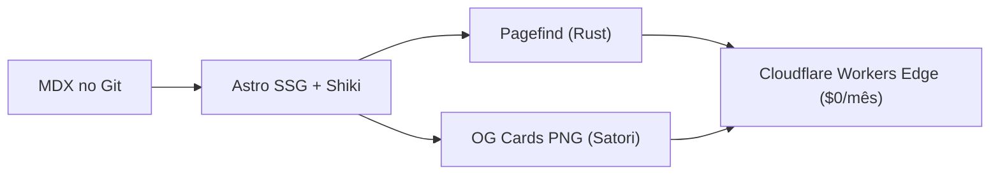

import Callout from '../../components/Callout.astro';

Decidi tirar o `kamity.dev` do papel para ter um lugar próprio onde eu consiga registrar problemas reais de engenharia com calma, código e contexto.

Post em rede social é ótimo para trocar ideia rápido, mas some do feed em três dias. Um texto bem escrito aqui fica fácil de buscar, serve de referência para mim mesmo meses depois e ainda dá base para discussões mais curtas no LinkedIn.

## O que vou escrever por aqui

A ideia é manter este espaço como um caderno aberto do que realmente estudo e construo:

- **Sistemas distribuídos e consistência:** locks distribuídos no Valkey, idempotência, concorrência e modelagem no PostgreSQL.
- **Baixa latência e Rust:** bastidores técnicos do projeto pessoal de servidor MMORPG e cliente nativo que uso como laboratório.
- **Arquitetura na prática:** onde DDD e Arquitetura Hexagonal pagam o esforço e onde só criam camada extra sem retorno.
- **Cloud e FinOps:** anotações de nuvem, infraestrutura barata e decisões de custo em CI e produção.

## Por que um blog estático em vez de CMS com banco

Antes de escrever a primeira linha, pensei em subir um CMS completo com banco de dados dedicado. Na prática, para um blog pessoal com alguns artigos por mês, manter VPS, PostgreSQL e rotina de backup rodando 24/7 só adiciona manutenção e conta mensal à toa.

A stack final ficou enxuta:

<Callout title="Trade-off escolhido">
  Abrir mão de painel dinâmico com banco tira recursos de edição multiusuário, mas entrega build
  versionado no Git, busca full-text estática no navegador com Pagefind e zero preocupação com
  servidor caindo se algum artigo receber pico de tráfego.
</Callout>

O plano agora é simples: publicar quando houver um problema real, uma medição ou um trade-off que valha a pena documentar.
