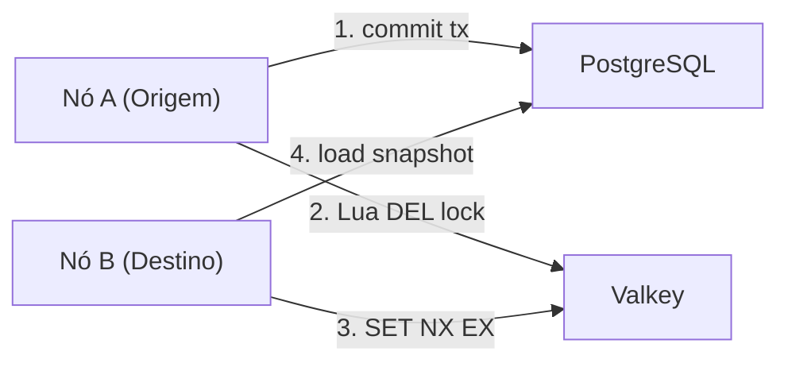

import Callout from '../../components/Callout.astro';

> Este arquivo está marcado com `draft: true`. Ele aparece em `pnpm dev` para você usar como referência de formatação, mas é ignorado automaticamente no `pnpm build` de produção.

## A janela de race condition

Descreva aqui o problema concreto que apareceu durante a troca de nó entre instâncias do servidor.



## Exemplo de bloco de código Rust

```rust
pub async fn handoff_player(
    db: &PgPool,
    valkey: &SessionLock,
    player_id: Uuid,
    lease_token: &str,
) -> Result<(), HandoffError> {
    let mut tx = db.begin().await?;
    persist_player_state(&mut tx, player_id).await?;
    tx.commit().await?;

    valkey.release_if_owner(player_id, lease_token).await?;
    Ok(())
}
```

## Trade-offs na mesa

<Callout title="Trade-off real">
  O lock elimina a corrida de leitura e escrita, mas exige calibrar bem o TTL do lease caso o nó de
  origem caia antes de liberar a chave.
</Callout>
